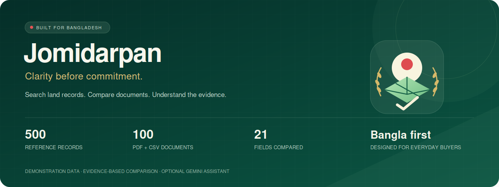
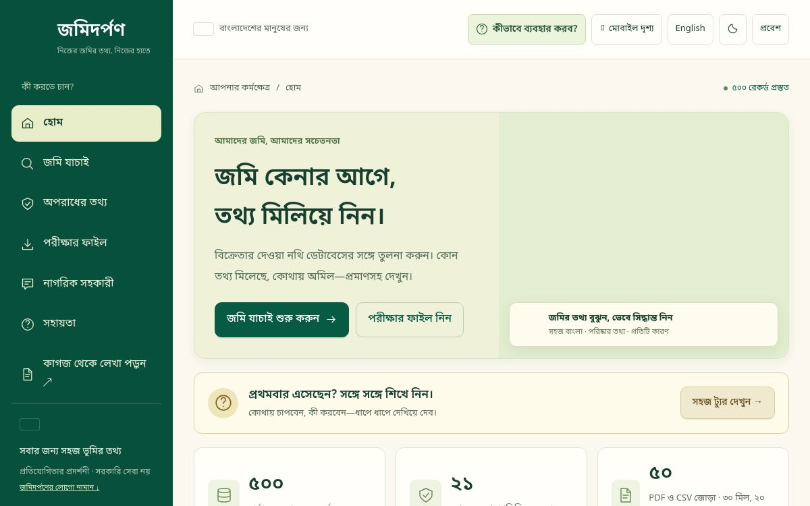
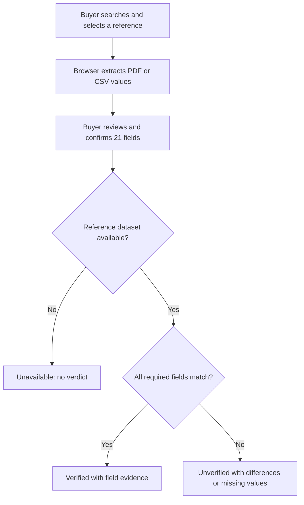

<p align="center"></p>
<h1 align="center">জমিদর্পণ · Jomidarpan</h1>
<p align="center"><strong>জমি কেনার আগে, তথ্য মিলিয়ে দেখুন।</strong><br>A Bengali-first, evidence-led pre-purchase land-document comparison prototype.</p>
<p align="center"><a href="https://jomidarpan.dncorleone1211.chatgpt.site"><strong>Live demo ↗</strong></a> · <a href="docs/USER_GUIDE.md">বাংলা নির্দেশিকা</a> · <a href="docs/COMPETITION.md">Competition alignment</a> · <a href="#19-testing">Tests</a> · <a href="#20-project-structure">Source map</a></p>

**Built for LandTech 2026 — LandTech Innovation Hackathon**, organized by DIU's Department of CSE & CSE-TECH, supported by the Department of Law. Primary problem: **P5 — Citizen Pre-Purchase Verification**, under **Digital Land Records, Verification & Digitization**. Supporting capabilities address parts of P1 digitization and P3 discrepancy analysis. This is a statement of project fit, not organizer certification.

| Quick facts | |
| --- | --- |
| Buyer question | “Do the seller's document values agree with the selected reference record?” |
| Reference corpus | 500 realistic demonstration records, served from D1 |
| Evaluation cases | 50 paired cases: 50 PDFs and 50 CSVs |
| Comparison scope | 21 reviewed fields with source-level evidence |
| Demonstration split | 30 matching and 20 nonmatching cases per format |
| AI | Pretrained OCR, experimental browser handwriting and optional Gemini explanations |
| Maintainer | [Deep Mitra](https://github.com/deepmitra2002); student/mentor roster must be supplied by the team |
| Competition source | [Supplied rulebook](docs/competition/landtech-2026-rulebook.pdf), especially §§3, 7–11 |

> **Verified means agreement with this demonstration database.** It does not establish ownership, certify a deed, clear a pending case or guarantee a safe purchase. The app has no live government or police connection.

**Navigate:** [Problem](#1-the-problem) · [Features](#3-features) · [Architecture](#4-how-it-works) · [AI depth](#5-ai-and-ml-depth) · [Privacy](#8-privacy-and-data-residency) · [Setup](#16-installation-and-setup) · [Testing](#19-testing) · [Disclosures](#disclosures)

## 1. The problem

A buyer may receive an owner's name, khatian, plot/dag number, deed dates, mutation status and land area from a seller. Those details are spread across different documents and offices. Reading a scanned Bangla record is difficult; manually checking every field makes discrepancies easy to overlook.

The supplied LandTech rulebook identifies forged deeds, conflicting khatians across survey generations and the separation between registration and mutation records as relevant problems. **Jomidarpan's bounded problem is to make seller-to-reference comparison understandable before a buyer commits to a transaction.** It helps the buyer locate a candidate record, review extracted information and see exactly what differs.

We do not claim that a matching sample record proves authenticity. Authoritative title, pending-case and acquisition verification require approved data access and professional validation beyond this prototype.

## 2. What Jomidarpan does

The buyer searches for a land record, selects the intended parcel, uploads one seller document, reviews the extracted fields and confirms a comparison. The result includes evidence for each field.

| Result | Trigger | Buyer sees |
| --- | --- | --- |
| **Verified** | All 21 required reviewed values agree with the selected record after supported normalization | Matched fields with reference/document values and provenance |
| **Unverified** | At least one field differs or is missing | The specific difference or missing-information reason |
| **Unavailable** | The request cannot be completed, including an incomplete reference database | An error; no successful verification claim |

Try **LND-0001 / plot 2001** with `submission-001.pdf` or `.csv`: 21 matches. Try **LND-0031** with submission **031**: 20 matches and an **owner** difference. The filename does not control the result; actual reviewed values do.

## 3. Features

| Capability | What works now | Boundary |
| --- | --- | --- |
| Land search | Record, plot/dag, khatian and deed search; Bangla/English digits | Explicit selection required when multiple candidates exist |
| PDF/CSV intake | PDF.js text extraction, Tesseract fallback, shared CSV parser | OCR can be wrong; buyer review is required |
| Field comparison | 21 fields; matched, different and missing evidence | Database agreement only |
| Crime search | Independent number search and eligible public sample reports | No report found means none in this dataset |
| Claim analysis | Separate rule-based discrepancy/claim analysis | Not an authoritative fraud finding |
| Document reader | Printed Bangla/English OCR; experimental WebGPU handwriting path | Hardware/model support and handwriting accuracy vary |
| AI assistant | Gemini explains concepts and allowlisted result summaries | Cannot change comparison decisions |
| Rural-friendly UX | Bengali-first copy, flag, rice/land logo, village illustration and larger controls | Usability with rural participants remains unmeasured |
| Mobile and guidance | Responsive bottom navigation, phone-width preview, nine-step tour | Desktop preview is not a physical-device test |
| Evidence and samples | Current evidence download/print, 500-record CSV and all 100 files | No saved-report archive or uploaded-original storage |

### App screenshots



*Actual hosting-platform capture of deployed version 5; some SVG/illustration assets are not displayed in this capture. It has not been edited.*

Land Verification, Crime Search, Sample Files, AI Assistant, mobile and tour screenshots remain pending supported browser capture. The banner is an illustration, not an app screenshot. See [capture provenance and checklist](docs/SCREENSHOTS.md). No screenshots from Thamun are used as Jomidarpan evidence.

## 4. How it works



The file is processed in the browser. The server receives reviewed values, the selected reference ID and provenance. It reads the same D1 dataset that powers search, then applies deterministic comparison rules. Missing values stay visible; they are not filled from the reference to manufacture a match.

The corpus is inserted idempotently after schema migrations create the tables. A partially populated corpus blocks verification. Normalization supports Bangla/English digits, whitespace, valid supported dates, numeric shares and supported area units. See [Architecture](docs/ARCHITECTURE.md), [API contracts](docs/API.md) and [dataset assumptions](docs/DATASET.md).

## 5. AI and ML depth

Jomidarpan combines **pretrained AI for reading and explanation** with **deterministic code for the decision**. It does not train a custom fraud classifier.

| Layer | Technology and role | Training/evaluation status |
| --- | --- | --- |
| Embedded PDF text | PDF.js reads existing text | Parsing, not ML |
| Printed Bangla/English OCR | Tesseract uses pretrained language assets | No team-trained model; representative OCR character/word error rates unmeasured |
| Experimental handwriting | Retained browser Qwen3.5-2B ONNX path through Transformers.js/WebGPU | Third-party pretrained model; device support and accuracy unmeasured |
| Field extraction | Label-based parser and CSV schema handling | Deterministic rules; exercised against the supplied corpus |
| Record comparison | Shared normalization and 21-field comparator | No learning/training, no probability score |
| Citizen assistant | Server-side Gemini through AI SDK | Optional general explanation; no fine-tuning or measured legal-answer accuracy |

**Measured now:** the document suite extracts all 50 PDFs and parses all 50 CSVs, giving 30 verified and 20 unverified outcomes for each format. These are designed fixture outcomes, not a real-world accuracy percentage. No AUC, precision/recall, training curve, SHAP analysis or model superiority claim is made because the prototype has no fitted fraud classifier.

**Next evaluation:** assemble a permitted synthetic/anonymized scan corpus; separate clean printed text, noisy scans and handwriting; measure OCR CER/WER, per-field extraction accuracy, correction effort, missed discrepancies and incorrect mismatch alerts. Keep comparison fixtures separate from that independent reading benchmark. [Evaluation plan](docs/VALIDATION.md).

## 6. Explainability and the LLM boundary

Every compared field carries a rule identifier, document value, reference value, status, reference/version metadata and source provenance. The buyer can inspect the difference rather than accepting a single unexplained score.

| Decision component | Can affect Verified/Unverified? | Explanation |
| --- | --- | --- |
| Reviewed input and selected reference | Yes | The buyer confirms what is being compared |
| Normalization and field rules | Yes | A missing or unequal required field prevents a match |
| Separate claim analysis | No direct replacement of the comparison verdict | Additional rule-based context, not legal proof |
| Gemini answer | **No** | Explains concepts/result counts; has no decision-writing tool |

The assistant may receive only an explicit question and optional allowlisted counts/field names. It does not automatically receive a document, owner name, reference ID or actual field value. Model output is rendered as text, not executable HTML. A provider failure does not prevent deterministic comparison.

## 7. Customer experience and alert fatigue

Land-document review is a deliberate buyer action, rather than a background stream of payment alerts. The design goal is to make discrepancies actionable without presenting every data gap as fraud.

| Choice | Purpose |
| --- | --- |
| Search before upload and explicit record selection | Reduce comparisons against the wrong parcel |
| Review screen before confirmation | Catch OCR errors before they become apparent mismatches |
| Matched/different/missing evidence | Distinguish a missing value from contradictory information |
| No automatic fraud accusation | Keep disagreement separate from criminal/legal conclusions |
| Edits invalidate old results | Prevent a stale verdict from remaining visible |
| Nine-step optional tour, Back/Skip/Escape and reduced motion | Help new users while allowing experienced users to proceed |
| Large Bengali controls and mobile bottom navigation | Reduce navigation and reading effort |

Task completion, correction time, mistaken record selection and warning comprehension have not yet been measured with real participants. We do not reuse Thamun's alert-fatigue statistics. Proposed user-testing measures are in [Validation](docs/VALIDATION.md).

## 8. Privacy and data residency

| Data/process | Current boundary |
| --- | --- |
| Original PDF/CSV | Browser processing; the rebuilt app does not upload/store the original |
| Reviewed fields | Sent to the application's Worker comparison endpoint |
| Reference corpus | Synthetic/sample data in source/downloads and D1 |
| Gemini question | Sent to Google's configured Developer API when submitted |
| Optional Gemini summary | Counts and allowlisted field names only |
| Usage counters | Time-bucket counters keyed by a daily IP hash in D1 |
| Saved reports and AI chat history | Not persisted by the application |

**Bangladesh-only residency is not guaranteed.** The hosted Worker/D1 infrastructure and optional Google processing are external services. Browser OCR avoids sending the document to Gemini, but that is not a claim that all application processing stays within Bangladesh. Experimental handwriting may download model assets from a third-party host.

The rulebook prohibits real personal/land records, government scraping and unauthorized third-party security testing. Use approved synthetic/sample data only. The supplied v5 bundle is treated as demonstration data; its precise provenance as team-created or organizer-provided must be confirmed by the team before submission. [Security/privacy notes](docs/SECURITY.md).

## 9. Security

| Control | Implemented behavior |
| --- | --- |
| Credential separation | Gemini key is a server secret, excluded from source and browser code |
| Input handling | Allowlisted comparison fields and bounded request bodies |
| Database access | Prepared D1 statements |
| Corpus integrity checks | Expected version/count; incomplete data blocks verification |
| Public report filtering | Ineligible/private QA report details omitted from public API results |
| Assistant origin check | Different explicit Origin rejected |
| Assistant abuse limits | D1-backed visitor/global quotas, bounded output and timeout |
| Output safety | Escaped application text, plain-text AI answers and sanitized provider failures |
| Invalidated evidence | Editing reviewed fields requires a new comparison |

**Not claimed:** penetration testing, signed land documents, QR authenticity, immutable ledger, comprehensive audit logging, complete production authorization or certification. A quota counter is not a full security monitoring system. Retained Sites sign-in does not mean every demo data route requires authentication. Demonstrate security only on this team's own prototype; do not probe government systems. [Security policy](docs/SECURITY.md).

## 10. Scalability and monitoring

Static UI/OCR assets are separate from the Worker APIs. D1 stores versioned reference records and assistant quotas; PDFs are processed in the browser rather than on the Worker. This limits server document-processing work in the current design.

| Area | Current evidence | Next work |
| --- | --- | --- |
| Dataset health | `/api/status`, 500-record assertion and partial-corpus failure test | Operational health alerts and migration/seed observability |
| Request handling | Isolated Worker integration checks | Representative concurrency/load tests |
| AI service | Timeouts, quotas and sanitized failure codes | Latency/error dashboards, budget monitoring and alert thresholds |
| Search | Exact search across the 500-record corpus | Indexed lookup and query plans before larger authorized corpora |
| Browser OCR | Work stays on the user's device | Low-cost Android memory/network/time benchmarks |
| Operations | Basic sanitized warnings and quota cleanup | Structured metrics, retention policy, recovery drills and SLOs |

No requests-per-second, p95 latency, availability target or countrywide capacity result has been measured. Serverless hosting alone does not prove scale. A future load test must state hardware/runtime, corpus, concurrency, durations, failure rates and percentile latency.

## 11. Business model

**Proposed, not validated:** a buyer-facing comparison service with an institutional subscription for permitted land-service/help-desk workflows. The demonstration remains a free prototype; no payments, subscription enforcement or commercial partner integration is implemented.

| Question | Working hypothesis |
| --- | --- |
| Who benefits? | Buyers who need clearer document comparison; assisted-service providers handling permitted records |
| Who might pay? | An institution subscribing for workflow/volume and support, subject to validation and lawful data access |
| What stays accessible? | Basic Bengali guidance and an understandable evidence summary |
| Cost drivers | OCR asset delivery, hosting/database use, AI requests, support, review and authorized-data integration |
| Sustainable design | Browser processing, optional AI and quotas to bound variable cost |
| Impact to measure | Time to review, overlooked discrepancy rate, correction effort, comprehension and cost per completed comparison |

No revenue, willingness-to-pay, prevented fraud loss or customer adoption result is claimed. A pilot should test value and costs before setting prices. [Business assumptions](docs/BUSINESS_MODEL.md).

## 12. Validation roadmap and user testing

1. **Completed:** deterministic fixture checks on all 100 documents, AI boundary tests, simulated-interface/tour tests and isolated Worker/D1 integration.
2. **Next:** independent OCR benchmark on permitted synthetic/anonymized scans, including noisy print and handwriting.
3. **Next:** moderated usability sessions with consent, using dummy documents; include rural Bengali readers and low-cost Android devices.
4. **Later:** domain-professional review of the evidence wording and permitted authoritative-data integration design.
5. **Before pilot:** identity/authorization, retention, abuse/load testing, operational monitoring and security review.

A proposed usability session asks participants to find the intended parcel, identify the owner mismatch in case 031, explain what Verified means and export evidence. Record completion, errors, time, corrections and understanding; do not collect real land records or unnecessary personal data. No participant count or study result is claimed yet. [Detailed validation plan](docs/VALIDATION.md).

## 13. Changes documented before the final round

The rulebook requires a README summary of changes between rounds. The available material does not identify a verified Round 1 submission commit, so this is a **dated development summary**, not a certified diff against the submitted version.

| Update documented on 18 October 2026 | Result |
| --- | --- |
| Rebuilt buyer flow around the coherent v5 corpus | 500 server records and corresponding reference CSV |
| Seller-document comparison | Review/confirmation and evidence for 21 fields |
| Data package | 50 PDFs + 50 CSVs with 30 matching / 20 nonmatching cases |
| Separate searches | Land lookup and public sample crime-report lookup |
| Report behavior | Removed saved-report archive; current evidence export remains |
| Branding and access | জমিদর্পণ identity, Bangladesh visual cues, mobile controls and guided tour |
| AI integration | Server-only Gemini explanations independent of verdicts |
| Repository presentation | Source folders, setup/testing docs and competition disclosure map |

The team should identify the actual Round 1 commit/video and review this summary against it. Existing GitHub history is preserved; imported source commits are exports from the prior Sites workflow, not reconstructed historical authorship. [Provenance](docs/PROVENANCE.md) and [Changelog](docs/CHANGELOG.md).

## 14. Limitations

- The 500 records and 50 paired cases are demonstration fixtures; provenance/competition permission needs team confirmation.
- Dataset agreement is not legal title verification, document authenticity, case clearance or acquisition clearance.
- P5 pending cases, khas and acquisition status are not comprehensively checked against authoritative sources.
- OCR, handwriting, smartphone performance and rural usability are not independently benchmarked.
- No custom ML training, real-world fraud-detection accuracy, clinical-style validation or production-scale load result exists.
- No government/police APIs, restored private case system, staff workflow, immutable ledger or digital-signature verification is implemented.
- Cloud/Google processing is not guaranteed to remain in Bangladesh.
- Additional app-tab/mobile screenshots and independent fresh-machine validation remain open items.

## 15. Technology stack

| Layer | Technology |
| --- | --- |
| Main interface | Bengali-first HTML/CSS/JavaScript, SVG branding and responsive navigation |
| Application shell | React 19, Vinext, Next.js-compatible routes, TypeScript and Vite |
| Runtime | Cloudflare Workers through ChatGPT Sites |
| Database | D1, Drizzle schema and SQL migrations |
| Document reading | PDF.js, Tesseract Bangla/English assets |
| Experimental handwriting | Transformers.js, Qwen3.5 ONNX and WebGPU |
| GenAI | AI SDK 7 and Google provider |
| Tests | Node test runner, Happy DOM, TypeScript and Miniflare |
| Package management | pnpm with a committed lockfile |

The exact versions are in [package.json](package.json) and [pnpm-lock.yaml](pnpm-lock.yaml). Retained starter components may be present without being used by the main studio.

## 16. Installation and setup

Use **Node.js 22.18+**, Git and the **pnpm version pinned in package.json**. No Python API or `requirements.txt` is part of this application's server stack.

```sh
git clone https://github.com/deepmitra2002/jomidarpan.git
cd jomidarpan
pnpm install --frozen-lockfile
# Restore executable bits for the retained shell helpers on Linux/macOS.
chmod +x scripts/*.sh
pnpm dev
```

The portable development command defaults to **http://localhost:5173**. Open `/studio.html`. Runtime bindings are declared in `vite.config.ts`; the app needs a local D1 `DB` binding for database routes. A clean clone defaults to the portable profile; ignored `.sites-runtime` state belongs to the original managed checkout.

For a fresh local database, build first and apply the two initial SQL migrations once. These exact local schema commands were exercised in the managed checkout; they never use `--remote`. Do not rerun initial `CREATE TABLE` files on an already provisioned database. The built local Worker uses the same `.wrangler/state` path.

```sh
pnpm build
node --import ./scripts/sites-env.mjs ./node_modules/wrangler/bin/wrangler.js d1 execute DB --local --config dist/server/wrangler.json --persist-to .wrangler/state --file drizzle/0000_wooden_exodus.sql
node --import ./scripts/sites-env.mjs ./node_modules/wrangler/bin/wrangler.js d1 execute DB --local --config dist/server/wrangler.json --persist-to .wrangler/state --file drizzle/0001_third_captain_universe.sql
pnpm start
```

For the separately isolated integration test, run `node scripts/test-server.mjs` after building. It creates its own D1 database, applies migrations, seeds 500 records and mocks Google.

The hosted deployment is working; an independent clean-machine development setup is not yet validated. See [setup notes](docs/SETUP.md) rather than assuming an HTML-only server supplies the APIs.

## 17. Environment variables

| Name | Purpose | Default/requirement |
| --- | --- | --- |
| `GEMINI_API_KEY` | Server-only Google credential | Required only for live AI answers; never commit |
| `GEMINI_BASE_URL` | Gemini Developer API base URL | `https://generativelanguage.googleapis.com/v1beta` |
| `GEMINI_MODEL` | Model available to the configured Google project | Current code fallback: `gemini-3.8-flash`; availability is account-dependent |
| `DB` | D1 runtime binding | Binding, not a client environment variable |

See [.env.example](.env.example) for non-secret names/defaults. Use ignored `.dev.vars` for local Worker secrets and Sites runtime secrets in production. Do not prefix a key for client exposure or put it in a screenshot/request example. Core comparison does not require Gemini.

## 18. Deployment

The live version is hosted by **ChatGPT Sites** on Cloudflare Workers/D1. GitHub is the source-review destination, not an automatic production-deployment trigger.

1. Preserve `.openai/hosting.json`, existing source identity, Sites build adapters and migration history when updating the existing Site.
2. Build the exact source with the supported Sites build workflow.
3. Push/package that exact source, save a version and deploy it with the existing audience.
4. Configure `DB` and server-side Gemini secrets in the hosting platform; do not embed a live key in the repository.
5. Check dataset health and exercise a matching and nonmatching case after deployment.

On another host, provision compatible Worker/D1 bindings and adapt identity/build settings. Vercel/Render commands from Thamun do not deploy this different stack unchanged. Database backups, recovery and production monitoring are future operational requirements. [Architecture](docs/ARCHITECTURE.md).

## 19. Testing

```sh
pnpm exec tsc --noEmit
node --test tests/documents.test.mjs tests/assistant.test.mjs tests/interface.test.mjs
pnpm build
node scripts/test-server.mjs
```

| Evidence | Observed result | What it establishes |
| --- | --- | --- |
| Document suite | 50 PDFs: 30 verified / 20 unverified; 50 CSVs: same | Shared extraction/parsing and comparison behavior on the supplied cases |
| All three Node suites | 10 tests passed in the 18 October local run | Normalization, missing/changed values, public-report filtering, AI safety and simulated UI |
| Isolated Worker/D1 integration | 500 seeded records; 30/20 comparison API outcomes | Built API flow, quotas, cross-origin rejection and partial-dataset failure |
| TypeScript and production build | Passed | Current implementation type/build checks |

The document test regenerates [test-report.json](public/downloads/test-report.json). It does not read a filename/manifest flag to choose the runtime outcome. AI tests mock Google; Happy DOM is not a real browser/device. The tests do not establish legal correctness, broad OCR accuracy or load capacity.

### Judge-friendly demo sequence

| Step | Do this | Expect |
| --- | --- | --- |
| 1 | Search `2001` or `২০০১` in land verification | Same plot search result |
| 2 | Select LND-0001; upload submission-001.pdf/csv; review and confirm | 21 matched fields, Verified |
| 3 | Select LND-0031; upload submission-031.pdf/csv | Owner difference, 20 matches, Unverified |
| 4 | Remove or change a reviewed value | Previous result invalidated; new missing/different evidence after comparison |
| 5 | Search available public sample reports | Eligible report details or no eligible report found |
| 6 | Ask “খতিয়ান কী?” in the assistant | Explanation, separate from database evidence |
| 7 | Run the tour and use phone-width view | Cross-tab guidance and responsive navigation |

Full coverage/limits: [Testing](docs/TESTING.md), [Data](docs/DATASET.md), [Validation](docs/VALIDATION.md).

## 20. Project structure

The application uses its actual Vinext/Worker structure. It is not renamed to imitate Thamun's Python folders.

| Path | Main contents |
| --- | --- |
| `app/api/land/route.ts` | Identifier search |
| `app/api/compare/route.ts` | Confirmed reviewed-field comparison |
| `app/api/crime/route.ts` | Public sample-report filtering |
| `app/api/assistant/route.ts` | Gemini endpoint and quota handling |
| `app/api/status/route.ts` | Dataset/session health |
| `app/`, `app/p5/` | Layout, identity helpers and studio redirects |
| `lib/jomi/` | Canonical fixtures, normalization, extraction, comparator and claim rules |
| `lib/ai/assistant.ts` | Question validation, model request and error sanitization |
| `public/studio.*`, `public/tour.js` | Main UI, mobile layout and nine-step guide |
| `public/reader.html`, reader scripts | OCR/experimental handwriting interface |
| `public/vendor/` | Local PDF/OCR/runtime assets and language models |
| `public/downloads/` | Reference CSV, 50 PDF/CSV pairs, bundles and test evidence |
| `db/`, `drizzle/`, `drizzle/meta/` | D1 schema, migrations and migration metadata |
| `components/`, `hooks/`, `vendor/` | Retained UI support and third-party styling assets |
| `tests/`, `scripts/test-server.mjs` | Document, AI, simulated-interface and Worker checks |
| `build/`, `scripts/`, `.openai/` | Sites/Vinext build integration and configuration |
| `docs/` | Competition alignment, architecture, APIs, validation and guides |
| `examples/d1/` | Retained starter D1 example, separate from active land routes |

See [Architecture](docs/ARCHITECTURE.md) for responsibilities and [Contributing](docs/CONTRIBUTING.md) for change expectations.

## Disclosures

- **Data:** user-supplied LandTech v5 demonstration bundle. It is not a live official registry. Older v2/SYN datasets are excluded from active comparison. Confirm permitted provenance before competition submission.
- **AI tools:** OpenAI ChatGPT/Codex assisted with rebuilding code, UI, tests and documentation. Google Gemini is an optional runtime explanation provider. Tesseract and the experimental Qwen path use third-party pretrained models; no custom training is claimed.
- **External components:** React, Vinext, Next.js-compatible tooling, Vite, Cloudflare Workers/D1 tooling, Drizzle, AI SDK/Google provider, PDF.js, Tesseract, Transformers.js, Qwen/ONNX assets, Happy DOM and retained UI/style packages. Exact versions and license notices remain in source. No new blanket license is assigned to third-party assets.
- **Authorship/history:** GitHub commits are preserved. Earlier native Sites history is separate; see [Provenance](docs/PROVENANCE.md). This README does not reconstruct earlier authorship or certify a Round 1 submission diff.
- **Reference presentation:** Thamun's README was consulted for documentation organization only. Jomidarpan has a different problem, implementation and evidence; no Thamun metrics, screenshots, team roster or model claims are presented as ours.
- **Rulebook:** [LandTech 2026 rulebook](docs/competition/landtech-2026-rulebook.pdf), supplied by the user. [Competition alignment](docs/COMPETITION.md) records implemented scope and remaining deliverables; it is not organizer approval.
