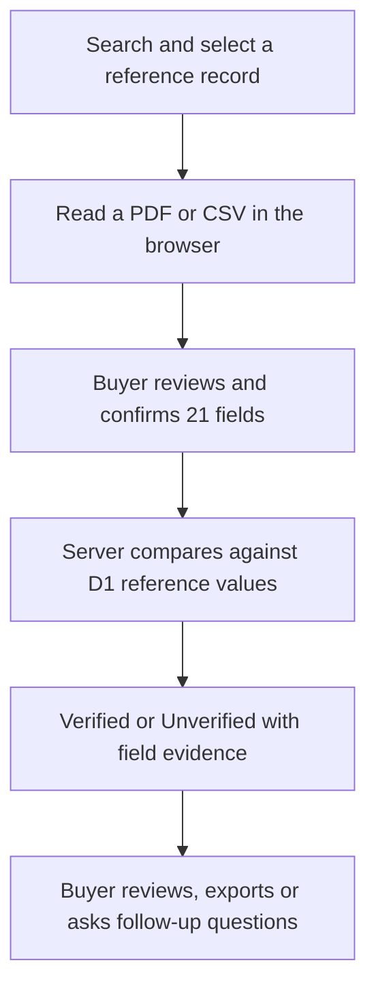

<p align="center">
  
</p>

<h1 align="center">জমিদর্পণ · Jomidarpan</h1>
<p align="center"><strong>জমি কেনার আগে, তথ্য মিলিয়ে দেখুন।</strong><br>Land-document comparison with evidence you can understand.</p>

<p align="center">
  
  
  
  
</p>

<p align="center">
  <a href="https://jomidarpan.dncorleone1211.chatgpt.site"><strong>Open live app ↗</strong></a> ·
  <a href="jomidarpan-complete-source.zip">Download source</a> ·
  <a href="USER_GUIDE.md">বাংলা নির্দেশিকা</a> ·
  <a href="#try-it-in-two-minutes">Try the demo</a>
</p>

---

## Why Jomidarpan exists

A buyer receives land details from a seller: an owner's name, plot number, khatian, deed and area. Finding the record is only the first step. The buyer also needs to see whether the seller's document agrees with that record—and exactly where it differs.

**Jomidarpan brings search, document reading, comparison and explanations into one Bengali-first workflow.** It shows evidence for the individual fields so a buyer can ask informed follow-up questions.

> **What “Verified” means here:** the reviewed document values match the selected record in this demonstration dataset. It does not establish legal title, certify ownership or guarantee a safe purchase.

| Project at a glance | |
| --- | --- |
| Audience | Land buyers in Bangladesh, including people who prefer simple Bengali interfaces |
| Core workflow | Search → select record → upload → review → compare → inspect evidence |
| Reference dataset | **500** server-backed demonstration records |
| Evaluation documents | **50 PDF + 50 CSV** files, representing 50 paired cases |
| Comparison | **21 fields**, with matched, different and missing values |
| Assistant | Optional Google Gemini explanations, separate from the verification decision |
| Current delivery | Complete source ZIP with preserved folders; project documentation browsable below |

**Explore:** [Features](#what-you-can-do) · [Demo](#try-it-in-two-minutes) · [How it works](#how-verification-works) · [Evidence](#tested-behavior) · [Setup](#run-the-source) · [Documentation](#documentation) · [Roadmap](ROADMAP.md)

## What you can do

| Area | User experience | Implementation |
| --- | --- | --- |
| **Land search** | Search by record, plot/dag, khatian or deed number; use Bangla or English digits | Number normalization and exact field search against the D1 dataset |
| **Document review** | Read a seller's PDF or CSV, then correct the extracted values before confirming | PDF.js text extraction, browser Tesseract fallback and shared CSV parsing |
| **Evidence comparison** | Understand which values match, differ or are missing | Deterministic comparison of 21 fields; field-level evidence and source provenance |
| **Crime search** | Look up available public sample reports by record | Server-side filtering of public demonstration reports |
| **Document reader** | Read printed Bangla/English text; explore experimental handwriting support | Browser OCR and retained reader assets |
| **AI assistant** | Ask for plain-language explanations | Server-side Gemini; it cannot modify the comparison result |
| **Quick tour** | Follow nine steps across tabs with scroll, spotlight, Back and Skip | Keyboard controls, focus handling and reduced-motion support |
| **Mobile experience** | Reach core tasks through bottom navigation and larger Bengali controls | Responsive layout and a desktop phone-width preview |
| **Downloads** | Download all sample documents individually or in bundles | 500-record reference CSV, 50 PDFs, 50 CSVs and evidence exports |

There is no saved-report archive. The buyer can download or print the current evidence result.

## Try it in two minutes

Open the [live app](https://jomidarpan.dncorleone1211.chatgpt.site) and choose **জমি যাচাই**. Sample files are available in the app's files tab and in `public/downloads/` inside the source ZIP.

| Step | Action | Expected result |
| --- | --- | --- |
| 1 | Search plot **2001** or record **LND-0001** | Select the matching reference record |
| 2 | Upload **submission-001.pdf** or **submission-001.csv** | Extracted values appear for review |
| 3 | Review every field, confirm and compare | **Verified**, with all 21 fields matching |
| 4 | Select **LND-0031** and upload **submission-031.pdf/csv** | **Unverified**, with the actual discrepancies or missing values shown |
| 5 | Edit a reviewed value | The old result is invalidated; compare again |
| 6 | Open the quick tour or switch to phone-width view | Explore the guided and mobile workflows |

**The app compares actual content.** File names, case numbers and expected-result metadata never determine the verdict.

## How verification works



The original document stays in the browser. The comparison endpoint receives the reviewed values, selected reference ID and provenance. The same D1 reference values power search and comparison. A partially populated dataset blocks verification.

| Result | Meaning | Evidence |
| --- | --- | --- |
| **Verified** | All required reviewed values match the selected record under the supported normalization rules | Individual matched values and their source |
| **Unverified** | One or more fields differ or are missing | Document value, reference value and discrepancy/missing status |
| **Unavailable** | A request cannot be completed, for example because the reference dataset is incomplete | An error; no successful verification is claimed |

Digits, whitespace, supported date formats and numeric units are normalized. Missing fields remain visible. Separate claim analysis is not a legal-title verdict. See [Architecture](ARCHITECTURE.md) and [Dataset guide](DATASET.md).

## Tested behavior

These results describe the included demonstration corpus and automated checks. They are **not a real-world accuracy estimate**.

| Check | Observed result | Scope |
| --- | --- | --- |
| All 50 PDFs | **30 verified · 20 unverified** | Actual PDF.js extraction and shared comparison code |
| All 50 CSVs | **30 verified · 20 unverified** | Actual CSV parsing and shared comparison code |
| Automated document, AI and interface suites | **10 tests passed** | Latest local run on 18 October 2026 |
| Built Worker and isolated D1 | **500 records; 30/20 API outcomes** | Search, comparison, quotas, public-report filtering and partial-dataset rejection |
| Type checking and production build | **Passed** | Current exported source |

See [Testing and evidence](TESTING.md). The source includes `tests/`, `scripts/test-server.mjs` and `public/downloads/test-report.json` so the checks can be inspected and repeated.

Real-device uploads, accessibility with assistive technology, OCR accuracy on diverse scans and performance at production scale remain unmeasured. Interface tests use a simulated DOM.

## The AI boundary

**Code compares the records. Gemini explains.** The assistant does not mark land as verified or alter field evidence.

| Control | Current behavior |
| --- | --- |
| Credentials | Server-side runtime secret; no API key in source or browser code |
| Context | User question plus an optional allowlisted summary of field names/counts |
| Document privacy | Original PDFs, record IDs, owner names and field values are not automatically sent to Google |
| Rendering | Plain text; model-generated HTML is not executed |
| Limits | Bounded input/output, 25-second timeout, six visitor requests/minute and 150 global requests/day |
| History | Quota counters are stored; question/answer history is not persisted by the application |
| Provider outage | Visible error with separate prewritten guidance |

The question itself goes to Google, so users should avoid placing private information in it. The app rejects likely identification/phone numbers and email addresses, but this is not a comprehensive data-loss-prevention system. [Security and privacy](SECURITY.md).

## Technology

| Layer | Stack |
| --- | --- |
| Interface | Bengali-first HTML, CSS and JavaScript; responsive navigation and SVG branding |
| Application | React 19, Vinext, Next.js-compatible routes, TypeScript and Vite |
| Runtime and storage | Cloudflare Workers and D1 through ChatGPT Sites |
| Documents | PDF.js, Tesseract and local OCR language assets |
| Assistant | AI SDK 7 with the Google Gemini provider |
| Validation | Node test runner, Happy DOM, TypeScript and Miniflare |
| Dependencies | pnpm with a committed lockfile |

## Run the source

**Source delivery:** download [jomidarpan-complete-source.zip](jomidarpan-complete-source.zip), extract it and enter the `jomidarpan` folder. All 300 exported files are listed with checksums in [SOURCE-MANIFEST.json](SOURCE-MANIFEST.json). The full application is currently packaged in the ZIP, not expanded in this GitHub tree.

Use **Node.js 22.18+** and the **pnpm version pinned in `package.json`**:

```sh
cd jomidarpan
pnpm install --frozen-lockfile
pnpm dev
```

The portable development command defaults to port **5173**. Open `/studio.html`. Apply the SQL migrations in `drizzle/` to the local D1 binding before testing the database APIs; first use then seeds the versioned reference corpus. Runtime bindings are configured in `vite.config.ts`.

```sh
# Type checking and document / AI / simulated-interface tests
pnpm exec tsc --noEmit
node --test tests/documents.test.mjs tests/assistant.test.mjs tests/interface.test.mjs

# Build, then exercise the Worker against an isolated test database
pnpm build
node scripts/test-server.mjs
```

The integration test mocks Gemini and applies migrations to its own database. An independent fresh-machine setup has not yet been verified. [Detailed testing notes](TESTING.md).

<details>
<summary><strong>Server configuration and deployment</strong></summary>

| Variable | Purpose |
| --- | --- |
| `GEMINI_API_KEY` | Server-only Google credential |
| `GEMINI_BASE_URL` | Gemini Developer API endpoint |
| `GEMINI_MODEL` | A model available to the configured Google project |

The source includes a blank-key `.env.example`. Local Workers development can use ignored `.dev.vars`; production uses Sites runtime secrets. Never place keys in client-side variables or commits.

The live app runs through **ChatGPT Sites**. Preserve its build adapters, `.openai/hosting.json` and existing migration history when maintaining that deployment. GitHub stores the exported source; uploading here does not provision a database or deploy a new Site version. Moving to another host requires runtime bindings and authentication configuration appropriate to that host.

</details>

## Documentation

| Guide | Read it for |
| --- | --- |
| [বাংলা ব্যবহার নির্দেশিকা](USER_GUIDE.md) | A simple walkthrough for buyers |
| [Architecture](ARCHITECTURE.md) | Components, APIs, data flow and hosting |
| [API reference](API.md) | Endpoint contracts, example requests and error behavior |
| [Dataset guide](DATASET.md) | Canonical records, 50 paired cases and normalization |
| [Testing](TESTING.md) | Reproducible checks and their limits |
| [Security and privacy](SECURITY.md) | Data handling, safeguards and reporting a vulnerability |
| [Contributing](CONTRIBUTING.md) | Development expectations and review checklist |
| [Roadmap](ROADMAP.md) | Implemented features and next validation steps |
| [Changelog](CHANGELOG.md) | Current prototype and repository updates |
| [Screenshot checklist](SCREENSHOTS.md) | Planned actual tab screenshots and capture guidance |

**Visual status:** the header is an original project illustration. Actual app-tab screenshots are pending supported browser capture; it is not an app screenshot.

## Source layout

Paths below are inside the extracted source archive.

| Directory | Responsibility |
| --- | --- |
| `app/api/` | Search, comparison, crime, status and assistant routes |
| `public/studio.*` and `public/tour.js` | Main app, responsive layout and guided tour |
| `public/reader.html` and OCR assets | Browser document reader |
| `lib/jomi/` | Reference data, parsers, rules and field comparison |
| `lib/ai/` | Gemini validation, instructions and request handling |
| `db/` and `drizzle/` | Database schema and SQL migrations |
| `public/downloads/` | Reference CSV, all 100 submission documents and bundles |
| `tests/` | Document, assistant and interface suites |
| `build/`, `scripts/`, `.openai/` | Build, hosting and integration support |

## Scope, ownership and next steps

This is a working prototype with realistic **demonstration data**. Government land APIs, police connectivity, authoritative ownership checks, restored staff administration and private case storage are not implemented. A public report search with no result only means no eligible report was found in this dataset.

Project repository maintained by [Deep Mitra](https://github.com/deepmitra2002). Development included AI coding assistance; the implemented checks and limitations are documented above. Third-party dependencies and retained assets keep their respective licenses/notices. No blanket redistribution license has been assigned to the whole project.

Start with [the live demo](https://jomidarpan.dncorleone1211.chatgpt.site), then inspect the [test evidence](TESTING.md) and [roadmap](ROADMAP.md).
